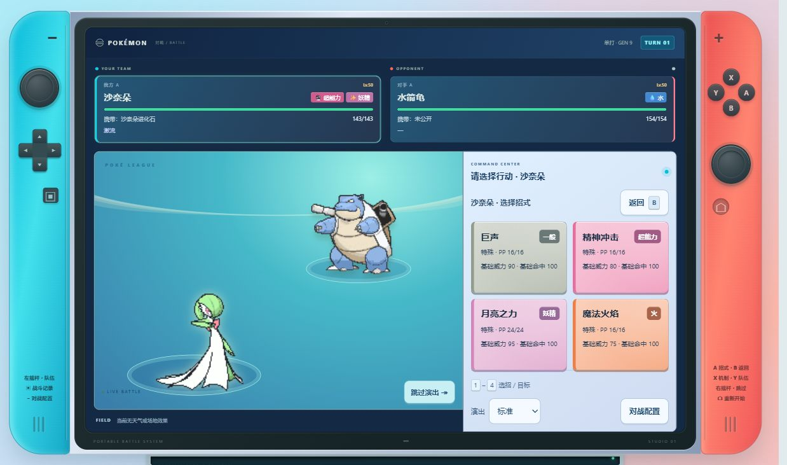
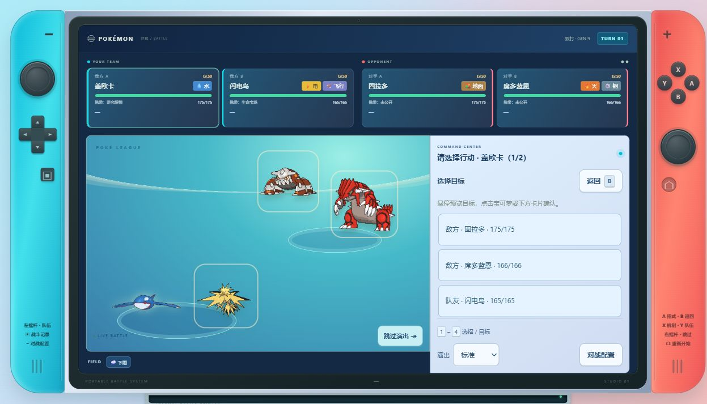
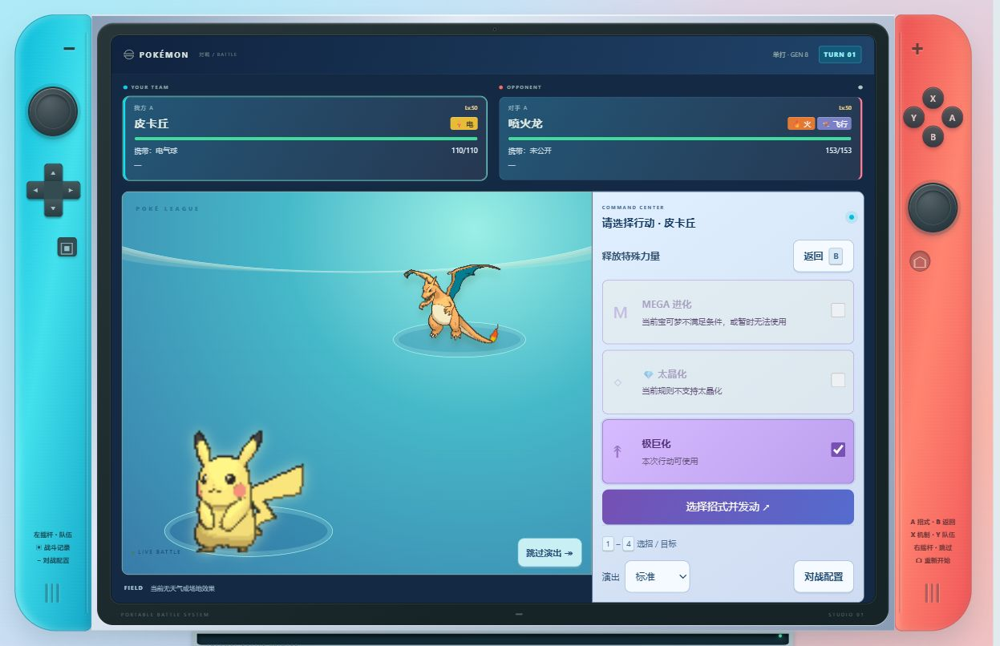
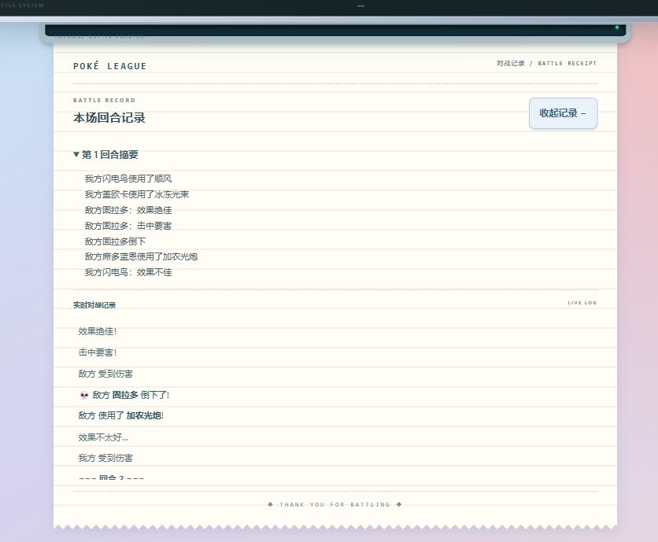

# st-ps 宝可梦战斗 · 1.1.0

基于 Pokémon Showdown 本地模拟核心的 SillyTavern 扩展。此次采用 Switch 第一版界面；战斗计算不调用 LLM。

## 界面预览

**单打：Switch 风格界面、属性色招式和携带物。**



<details>
<summary>查看更多：双打、极巨化选择和纸带记录</summary>

**双打：四只宝可梦同场，可在场上或列表中选择招式目标。**



**特殊机制：Gen 8 场景中选择极巨化，面板显示其他机制不可用的原因。**



**纸带记录：查看上一回合摘要和逐条战斗日志。**



</details>

## 安装与更新

将本目录的文件放在 GitHub 仓库根目录（manifest.json、index.js 与 dist 必须同级）。SillyTavern 扩展安装使用该仓库地址，安装后刷新页面。更新已有仓库时覆盖同名文件并添加新文件；不要只上传 ZIP 或把整个目录再套一层。

本包保留原作者信息与 LICENSE，包含可运行构建产物、第三方声明和 source 下的开发源码。

## 功能

- 第一版 Switch 界面、中文名称、属性色招式、大按钮、纸带日志和回合摘要。
- 单打、双打、目标选择、换人，以及规则和宝可梦允许时的 Mega / 太晶 / 极巨。
- 携带物公开信息、天气/场地/异常与能力变化说明；说明资料未完全汉化时保留英文。
- 基础敌方 AI、演出速度与跳过、可选音效。
- 嵌入模式只用宿主传入队伍；隐藏试玩场景、队伍配置、重新开始和设计切换。
- 结算区分胜利、失败、平局；仅接受当前战斗 iframe、相同来源的有效战报，按 battleId 防重复。

不包含投球捕捉、背包消耗或冒险 HP 同步。开局按引擎默认满血，结束战报为剧情结果，不是存档血量回写。

## 世界书输出格式

将[通用战斗提示词](BATTLE-PROTOCOL.zh-CN.md)全文放进模型可见的系统提示或世界书，替换已有的战斗输出规则，避免两套格式冲突。它只约束插件协议，不依赖特定角色卡、世界观或 MVU。

插件识别 `[pkbattlestart]` 与 `[pkbattleend]`，本次保持该标签协议。它不识别网页宿主的 `<battle>` 标签。

team 使用 Showdown 队伍文本的 JSON 字符串，换行写作 \n，多只宝可梦之间使用 \n\n。名字、招式、特性、道具使用引擎支持的英文标识；界面显示会翻译为中文。

```text
[pkbattlestart]
{
  "mode": "singles",
  "gen": "gen9",
  "p1": {"team": "Pikachu @ Light Ball\nAbility: Static\nLevel: 50\n- Thunderbolt\n- Quick Attack"},
  "p2": {"team": "Blastoise\nAbility: Torrent\nLevel: 50\n- Water Pulse\n- Ice Beam"}
}
[pkbattleend]
```

mode 为 singles 或 doubles；gen 为 gen9 或 gen8。Gen 8 提供极巨化，具体能否使用由引擎请求决定。输出后点击消息下的“遭遇战”按钮。

## 结算行为

结算后保留原插件的交互方式：填入酒馆输入框并点击发送来继续剧情。手动关闭战斗不发送战报。现有输入框草稿、生成中的酒馆会话等实际交互请在发布前按验收清单确认。

## 验证范围

详见 RELEASE-NOTES.md。本地自动测试和模拟宿主可以验证核心交互；未宣称已在真实 SillyTavern 的所有版本及主题中验收。建议先在测试聊天中安装并完成一局，再给正式角色卡使用。

## 修改源码与重建

需要 Node.js/npm。在项目根目录运行：

```sh
npm ci --prefix source/engine
node source/build-release.mjs
node --test source/engine/tests/*.test.mjs
```

source/engine 内是本次构建所用的引擎源码与锁文件。根目录 index.js、battle-host.mjs、style.css 和 manifest.json 是宿主端源码，可直接编辑。

图片素材仍可能请求外部宝可梦精灵图；网络不可用时有后备图标。计算引擎在本地运行不等于全部图片已离线打包。
